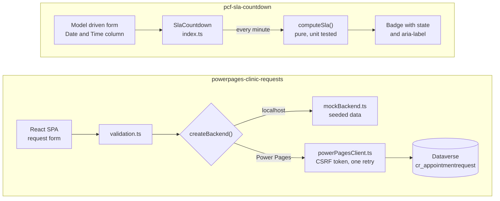

# Power Platform proof projects

     

Two small, tested builds that show pro-code work alongside Microsoft Power Platform:

| Project | What it is | Stack |
|---|---|---|
| [pcf-sla-countdown](pcf-sla-countdown/) | A PCF field control that shows how long is left before a due date, with green, amber, red and overdue states | Power Apps Component Framework, TypeScript, Vitest |
| [powerpages-clinic-requests](powerpages-clinic-requests/) | A Power Pages code site for a fictional clinic, where patients request an appointment (with POPIA consent) and signed-in users see their own requests | Power Pages Web API, React, Vite, TypeScript, Vitest |

Both projects build cleanly and have 57 automated tests each. Each folder has its own README with how to run it locally and how to deploy it to a Dataverse environment with the Power Platform CLI.

## Architecture



## Results

Measured on 21 October 2026 on this repo, Node 24.13.1.

| Check | pcf-sla-countdown | powerpages-clinic-requests |
|---|---|---|
| Automated tests | 57 of 57 pass (2 files) | 57 of 57 pass (4 files) |
| Typecheck | clean | clean |
| Lint | clean (Power Apps ESLint rules) | no linter configured |
| Production build | succeeds, `bundle.js` 16.8 KiB | succeeds, JS 254.86 kB (80.12 kB gzip) |

Test output, pasted from the run:

```
pcf-sla-countdown
 Test Files  2 passed (2)
      Tests  57 passed (57)
   Duration  832ms

powerpages-clinic-requests
 Test Files  4 passed (4)
      Tests  57 passed (57)
   Duration  371ms
```

Where the tests sit:

| Test file | Tests |
|---|---|
| `pcf-sla-countdown/test/sla.test.ts` | 47 |
| `pcf-sla-countdown/test/SlaCountdown.test.ts` | 10 |
| `powerpages-clinic-requests/src/domain/validation.test.ts` | 25 |
| `powerpages-clinic-requests/src/api/powerPagesClient.test.ts` | 12 |
| `powerpages-clinic-requests/src/api/mockBackend.test.ts` | 11 |
| `powerpages-clinic-requests/src/api/powerPagesRequests.test.ts` | 9 |

Every badge colour pair in the PCF control passes WCAG AA, with contrast between 6.15:1 and 11.53:1 (table in [pcf-sla-countdown](pcf-sla-countdown/README.md#states)). On the Power Pages site no web role has Write or Delete, and the Web API fields setting lists every column explicitly.

## Run them locally

```
cd pcf-sla-countdown && npm install && npm start
```

Opens the PCF test harness at http://localhost:8181.

```
cd powerpages-clinic-requests && npm install && npm run dev
```

Opens the site with mock data at http://localhost:5180.

Built by Ruan Grobler, Microsoft Certified: Power Platform Fundamentals.
