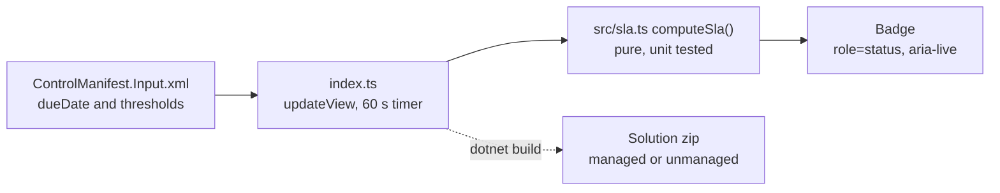

# SLA Countdown Badge

A Power Apps component framework (PCF) field control that turns a due date into a live, colour-coded countdown badge.

## What it does and why

Approvals, tickets, cases and purchase requests usually carry a due date, but a raw date on a form makes people do arithmetic. "Is 14 March at 16:00 soon? Have we already missed it?" That small friction is how SLAs get breached quietly.

This control replaces the date with a badge that answers the only question that matters: how long is left.

- **On track** in green, while there is plenty of time.
- **Warning** in amber, once the item is inside the warning window (24 hours by default).
- **Critical** in red, once it is inside the critical window (4 hours by default).
- **Overdue** in dark red, with how far past due it is.
- **No due date** in neutral grey, when the column is empty.

The badge refreshes itself every minute, so a form left open on a second screen stays accurate without a reload.

## States

| State | Example text | Colours (text on background) | Contrast |
| --- | --- | --- | --- |
| On track | `5d 3h left` | `#0B5A08` on `#DFF6DD` | 7.40:1 |
| Warning | `20h 5m left` | `#7A4100` on `#FFF4CE` | 7.39:1 |
| Critical | `3h 12m left`, `Due now` | `#A4262C` on `#FDE7E9` | 6.15:1 |
| Overdue | `Overdue by 1d 2h` | `#FFFFFF` on `#750B1C` | 11.53:1 |
| No due date | `No due date` | `#3B3A39` on `#F3F2F1` | 10.15:1 |

Every pair passes WCAG AA for normal text (4.5:1). Each state also has its own icon shape (tick, triangle, alert, clock, dash), so the state never depends on colour alone.

### Rules

- Text shows the two largest units and drops a trailing zero: `2d 5h`, `2d`, `3h 12m`, `3h`, `45m`.
- Time is rounded down to whole minutes, so the badge never claims more time than is really left.
- Thresholds are inclusive. With the defaults, exactly 24 hours left is a warning and exactly 4 hours left is critical.
- Thresholds are compared on the whole minutes shown on the badge, so the colour always agrees with the number.
- In the final minute before the deadline the badge says `Due now` (critical). From the moment the deadline passes it is overdue: `Overdue` for the first minute, then `Overdue by 5m`, `Overdue by 1d 2h` and so on.
- If the critical threshold is set higher than the warning threshold, critical wins and the amber band is skipped.

## Properties

| Property | Type | Usage | Required | Default | What it does |
| --- | --- | --- | --- | --- | --- |
| `dueDate` | `DateAndTime.DateAndTime` | bound | Yes | | The date and time column the SLA is measured against. |
| `warningHours` | `Whole.None` | input | No | `24` | The badge turns amber when this many hours or fewer remain. |
| `criticalHours` | `Whole.None` | input | No | `4` | The badge turns red when this many hours or fewer remain. |
| `label` | `SingleLine.Text` | input | No | | Optional text shown before the countdown, for example `Approval SLA`. |

Missing or invalid threshold values fall back to the defaults. Negative values are treated as 0.

The control is display only. It reads the bound column and never writes to it.

## Accessibility

- The badge has `role="status"` and `aria-live="polite"`, so it never interrupts a screen reader.
- Its `aria-label` is always a full, current sentence, for example `Due in 2 days 5 hours, warning` or `Approval SLA: Overdue by 1 day 2 hours`.
- Screen readers are told about **state changes** (for example warning to critical), not every minute of the countdown. Announcing each tick would be noise.
- When the form is read only or the field is disabled (`context.mode.isControlDisabled`), the badge keeps its SLA colours, because the deadline still matters, and switches to a dashed border to show it is locked.
- When the platform hides the field (`context.mode.isVisible` is false), the badge is hidden too.
- In Windows High Contrast and other forced-colour modes the badge falls back to system colours with a visible border.

## Project layout

```
pcf-sla-countdown/
  SlaCountdown/                    The PCF control
    ControlManifest.Input.xml      Manifest: namespace RuanGrobler, constructor SlaCountdown
    index.ts                       Control lifecycle: init, updateView, getOutputs, destroy
    css/SlaCountdown.css           Badge styles and colour tokens
    strings/SlaCountdown.1033.resx Display names and descriptions makers see (English)
    generated/ManifestTypes.d.ts   Types generated from the manifest on every build
  src/sla.ts                       Pure time maths: no DOM, no PCF, fully unit tested
  test/sla.test.ts                 Unit tests for the maths
  test/SlaCountdown.test.ts        Control tests in a simulated DOM (happy-dom)
  Solutions/SlaCountdownSolution/  Dataverse solution project that packages the control
  pcf-sla-countdown.pcfproj        MSBuild project used by the solution build
  package.json, pcfconfig.json, tsconfig.json, eslint.config.mjs
```

All of the decision making lives in `src/sla.ts`. The control in `SlaCountdown/index.ts` only reads the PCF context, calls `computeSla()`, and paints the result. That split keeps the rules testable in plain Node and keeps the control thin.



## Run it locally

You need Node.js (an LTS release: 20, 22 or 24) and npm.

```bash
npm install
npm run build        # validates the manifest, lints, bundles to out/controls
npm test             # unit and control tests (vitest)
npm run typecheck    # strict TypeScript over the control, the maths and the tests
npm run lint         # Power Apps ESLint rules
```

### Test harness

```bash
npm start
```

This builds the control and opens Microsoft's PCF test harness at **http://localhost:8181**. If that port is busy, the harness picks the next free one and prints it in the terminal.

Use `npm run start:watch` to rebuild and reload on every save.

In the harness, open the **Data Inputs** panel on the right to set `dueDate`, `warningHours`, `criticalHours` and `label`. The harness starts `dueDate` at 1 January 2019, so the first thing you see is an overdue badge. Type a date a few hours or days ahead to see the other states.

## Package and import into Dataverse

You need the [Power Platform CLI](https://learn.microsoft.com/power-platform/developer/cli/introduction) (`pac`) and, on macOS or Linux, the .NET SDK 6 or later. Use a development or sandbox environment first.

### Option 1: quick push for development

Sign in once, then push from the project folder:

```bash
pac auth create --environment https://yourorg.crm.dynamics.com
pac pcf push --publisher-prefix rg
```

`pac pcf push` builds the control, wraps it in a temporary solution and imports it into the environment selected by your auth profile. It skips version checks, which makes it ideal for fast iteration but not for moving between environments. The publisher prefix should match the prefix of the solution you will eventually ship the control in.

### Option 2: solution package for real deployments

The solution project is already set up in `Solutions/SlaCountdownSolution` with publisher `RuanGrobler` and prefix `rg`. It references this control.

```bash
cd Solutions/SlaCountdownSolution
dotnet build                           # unmanaged: bin/Debug/SlaCountdownSolution.zip
dotnet build --configuration Release   # managed:   bin/Release/SlaCountdownSolution.zip
```

Then import the zip, either in the browser (make.powerapps.com, **Solutions**, **Import solution**) or from the CLI:

```bash
pac solution import --path bin/Release/SlaCountdownSolution.zip --publish-changes
```

Use the unmanaged package in your development environment and the managed package for test and production.

If you rebuild the solution after a code change, bump the `version` attribute in `ControlManifest.Input.xml` (for example `1.0.0` to `1.0.1`). Dataverse only replaces a control when its version goes up.

To recreate the solution project from scratch:

```bash
mkdir -p Solutions/SlaCountdownSolution && cd Solutions/SlaCountdownSolution
pac solution init --publisher-name RuanGrobler --publisher-prefix rg
pac solution add-reference --path ../..
```

### Add it to a form

1. Open a model-driven form in the form designer.
2. Select a **Date and Time** column, for example the due date on an approval or a case.
3. In the properties pane, open **Components**, choose **+ Component** and pick **SLA Countdown Badge**.
4. Optionally set the warning hours, critical hours and label, then save and publish the form.

For canvas apps, an admin must first turn on **Allow publishing of canvas apps with code components** in the environment settings. Then use **Insert**, **Get more components**, **Code** to add it.

## Notes

- The control is built for Date and Time columns with the default **User local** behaviour, where the value is a real point in time. For **Time zone independent** columns, check the badge against the deadline you expect before relying on it.
- Badge text is English. The maker-facing names and descriptions live in the resx file, so adding another `strings/SlaCountdown.<lcid>.resx` localises the configuration screens.
- No external services are called (`external-service-usage enabled="false"`), so the control is not a premium component.
